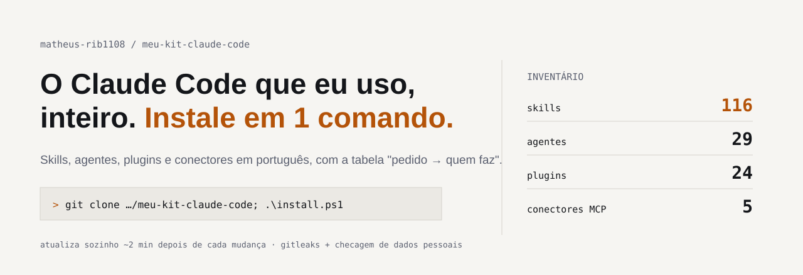
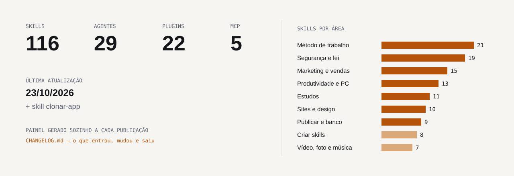
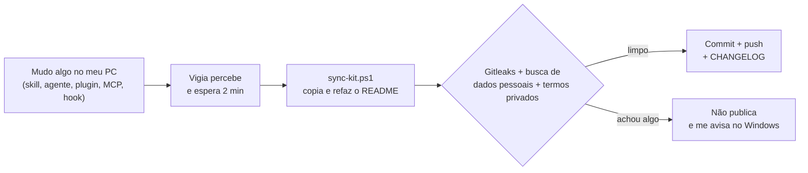
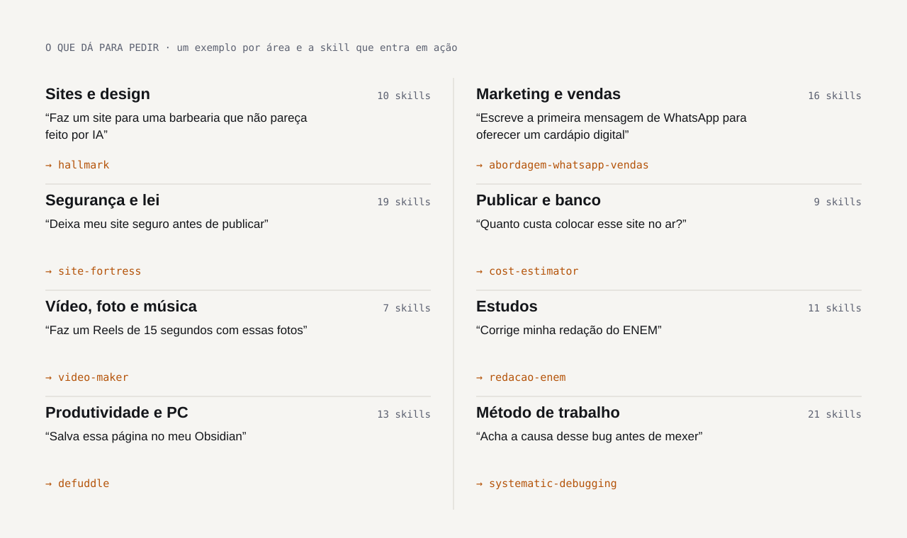

<picture>
  <source media="(prefers-color-scheme: dark)" srcset="assets/banner-dark.svg">
  
</picture>

     

Tudo o que eu uso no [Claude Code](https://claude.com/claude-code), num lugar só: **127 skills**,
**29 agentes**, **31 plugins**, **5 conectores MCP** (sem nenhuma chave), os hooks,
o que está ativado na [minha conta claude.ai](#minha-conta-claudeai) e o meu `CLAUDE.md` com a tabela
"pedido → quem faz", que diz ao Claude qual agente ou skill usar em cada pedido.

<p align="center">
  <a href="#no-claudeai-ou-no-app-do-claude-sem-programar"><b>Usar no claude.ai / app</b></a> ·
  <a href="#no-claude-code-tudo-de-uma-vez"><b>Instalar no Claude Code</b></a> ·
  <a href="#todas-as-skills">Ver as skills</a> ·
  <a href="#avalie-e-sugira">⭐ Avaliar e sugerir</a>
</p>

## Como é usar



1. **Você pede em português**, do jeito que falaria com alguém: "faz um site para um salão", "corrige minha redação",
   "deixa meu site seguro".
2. **O `CLAUDE.md` decide quem faz.** Ele tem uma tabela "pedido → quem faz" que aponta a skill ou o agente certo
   para cada tipo de pedido, então você não precisa decorar nome de skill.
3. **As skills fazem o trabalho do jeito certo** (sem "cara de IA", com LGPD, com teste de segurança) e
   **nada é publicado, enviado ou comprado sem o seu ok.**

## Estado do kit

<picture>
  <source media="(prefers-color-scheme: dark)" srcset="assets/painel-dark.svg">
  
</picture>

O repositório se atualiza sozinho. Quando eu adiciono, mudo ou removo uma skill, agente, plugin, conector, hook
ou configuração no meu PC, isto acontece:



O que mudou em cada atualização fica no [`CHANGELOG.md`](CHANGELOG.md). **Última mudança:** 27/10/2026

> Skills de terceiros estão aqui com a licença original (arquivo `LICENSE` e `FONTE.md` em cada pasta).

## Instalar

### No claude.ai ou no app do Claude (sem programar)

<p align="center">
  <a href="https://github.com/matheus-rib1108/meu-kit-claude-code/releases/download/skills/todas-as-skills.zip"><b>⬇ Baixar todas as skills (.zip)</b></a> ·
  <a href="#todas-as-skills">Escolher uma skill</a> ·
  <a href="#avalie-e-sugira">⭐ Avaliar</a>
</p>

1. Na [tabela de skills](#todas-as-skills), clique em **.zip** na linha da skill que você quer.
2. No Claude: **Configurações → Capacidades → Skills → Enviar skill** e escolha o arquivo baixado. **Não descompacte.**
3. Pronto. Peça normalmente, em português: o Claude abre a skill sozinho quando o pedido combina.

No claude.ai cada .zip é **uma** skill. O `todas-as-skills.zip` serve para o Claude Code ou para descompactar e escolher.
Os .zip se refazem sozinhos a cada mudança no kit.

### No Claude Code: tudo de uma vez

Windows (PowerShell):

```powershell
git clone https://github.com/matheus-rib1108/meu-kit-claude-code.git
cd meu-kit-claude-code
powershell -ExecutionPolicy Bypass -File .\install.ps1
```

Mac / Linux:

```bash
git clone https://github.com/matheus-rib1108/meu-kit-claude-code.git
cd meu-kit-claude-code
sh install.sh
```

O instalador copia as skills para `~/.claude/skills`, os agentes para `~/.claude/agents` e mostra os comandos
dos plugins. **Não apaga nada**: se uma skill ou um agente com o mesmo nome já existe, ele pula (use `-Force` /
`--force` para sobrescrever). Para testar sem mexer na sua pasta: `install.ps1 -Destino C:\pasta\de\teste`.

O `CLAUDE.md` e o `.mcp.json` não são instalados sozinhos, porque você provavelmente já tem os seus:
copie à mão o que quiser de [`CLAUDE.md`](CLAUDE.md) e [`mcp/.mcp.json`](mcp/.mcp.json).

### No Claude Code: só uma skill

```powershell
powershell -ExecutionPolicy Bypass -File .\install.ps1 -Skill site-fortress
```

```bash
sh install.sh --skill site-fortress
```

Ou copie a pasta `skills/<área>/<nome>` para `~/.claude/skills/<nome>`.

### Plugins

Dentro do Claude Code:

```
/plugin marketplace add anthropics/claude-plugins-official
/plugin install context7@claude-plugins-official
```

A lista completa, com o comando de cada um, está na tabela de plugins abaixo e em [`plugins/plugins.json`](plugins/plugins.json).
Plugins oficiais não são copiados para cá: só a lista.

## Exemplos de pedidos por área

<picture>
  <source media="(prefers-color-scheme: dark)" srcset="assets/areas-dark.svg">
  
</picture>

Mais exemplos:

| Área | Peça assim |
|---|---|
| Sites e design | "Faz um site para uma barbearia que não pareça feito por IA" · "Escolhe paleta e fontes para uma pizzaria" |
| Marketing e vendas | "Reescreve o texto da página inicial" · "Escreve a primeira mensagem de WhatsApp para oferecer um cardápio digital" |
| Método de trabalho | "Planeja antes de mexer" · "Acha a causa desse bug" · "Responde curto (caveman)" |
| Segurança e lei | "Deixa meu site seguro antes de publicar" · "Escreve a política de privacidade e o banner de cookies (LGPD)" |
| Publicar e banco | "Quanto custa colocar esse site no ar?" · "Publica na Vercel" · "Cria o banco no Neon" |
| Produtividade e PC | "Salva essa página no meu Obsidian" · "O que tá acontecendo na outra conversa?" |
| Vídeo, foto e música | "Faz um Reels de 15 s com essas fotos" · "Tira o fundo dessa foto" · "Escreve um jingle" |
| Estudos | "Corrige minha redação do ENEM" · "Formata meu trabalho na ABNT" · "Resolve essa questão passo a passo" |
| Criar skills | "Cria um agente que me ajuda a estudar" · "Procura skills de Excel e instala as seguras" |
| Atualizar este kit | "Atualiza meu kit no GitHub" (skill `kit-sync`) |

## Alternativas grátis a ferramentas pagas

Ferramentas que aparecem muito em vídeos mas pedem conta, chave ou assinatura, e o que fazer no lugar sem pagar:

| Em vez de | Use | Como |
|---|---|---|
| Strix (pentest com IA, pede chave) | `site-fortress` + `dast-zap` + `dast-nuclei` | Ataca só o seu site, parte por parte, e corrige o que achar |
| 21st.dev Magic (catálogo de componentes, pede chave) | `componentes-ui` | Busca e instala componentes grátis do shadcn/ui, Magic UI e Aceternity, mais logos do SVGL |
| Firecrawl (raspar sites, pede chave) | `raspar-site` + `defuddle` | Várias páginas de um site viram Markdown, respeitando o robots.txt |
| PostHog (analytics) | `analytics-gratis` | Vercel Analytics + Speed Insights ou Umami, sem cookie |
| Perplexity (pesquisa) | `deep-research` | Vários agentes pesquisam em paralelo e citam as fontes |
| Composio (conectar apps) | conectores MCP (`/mcp`) | Cada app com o conector oficial, sem um intermediário com acesso a tudo |
| Higgsfield (vídeo com IA, pago) | `video-maker` + HyperFrames | Vídeo montado com código e as suas fotos e vídeos. Não gera cena do zero com IA. |

<a id="todas-as-skills"></a>

## Skills (127: 124 copiadas, o resto só com link)

### Sites e design (10)

| Skill | O que faz | Baixar | Fonte | Licença | Entrou |
|---|---|---|---|---|---|
| [`apple-design`](skills/sites-e-design/apple-design) | Revisão de design com os princípios da Apple (toque, animação com mola, tipografia, movimento reduzido). | [.zip](https://github.com/matheus-rib1108/meu-kit-claude-code/releases/download/skills/apple-design.zip) | [emilkowalski/skills](https://github.com/emilkowalski/skills) | MIT | 16/10/2026 |
| [`frontend-design`](skills/sites-e-design/frontend-design) | Design visual intencional e marcante para interfaces | [.zip](https://github.com/matheus-rib1108/meu-kit-claude-code/releases/download/skills/frontend-design.zip) | [anthropics/skills](https://github.com/anthropics/skills) | Apache-2.0 | 15/10/2026 |
| [`hallmark`](skills/sites-e-design/hallmark) | Anti "cara de IA": direção visual, auditoria e redesign de páginas | [.zip](https://github.com/matheus-rib1108/meu-kit-claude-code/releases/download/skills/hallmark.zip) | [Nutlope/hallmark](https://github.com/Nutlope/hallmark) | MIT | 15/10/2026 |
| [`site-architecture`](skills/sites-e-design/site-architecture) | Estrutura de páginas, menus e navegação do site | [.zip](https://github.com/matheus-rib1108/meu-kit-claude-code/releases/download/skills/site-architecture.zip) | [coreyhaines31/marketingskills](https://github.com/coreyhaines31/marketingskills) | MIT | 15/10/2026 |
| [`theme-factory`](skills/sites-e-design/theme-factory) | Temas prontos (cores + fontes) para páginas e documentos | [.zip](https://github.com/matheus-rib1108/meu-kit-claude-code/releases/download/skills/theme-factory.zip) | [anthropics/skills](https://github.com/anthropics/skills) | Apache-2.0 | 15/10/2026 |
| [`ui-ux-pro-max`](skills/sites-e-design/ui-ux-pro-max) | Estilo, paleta, fontes e estrutura certos para cada tipo de negócio | [.zip](https://github.com/matheus-rib1108/meu-kit-claude-code/releases/download/skills/ui-ux-pro-max.zip) | [nextlevelbuilder/ui-ux-pro-max-skill](https://github.com/nextlevelbuilder/ui-ux-pro-max-skill) | MIT | 15/10/2026 |
| [`vercel-react-best-practices`](skills/sites-e-design/vercel-react-best-practices) | Boas práticas de desempenho em React e Next.js | [.zip](https://github.com/matheus-rib1108/meu-kit-claude-code/releases/download/skills/vercel-react-best-practices.zip) | [vercel-labs/agent-skills](https://github.com/vercel-labs/agent-skills) | MIT | 15/10/2026 |
| [`web-artifacts-builder`](skills/sites-e-design/web-artifacts-builder) | Páginas HTML complexas com React, Tailwind e shadcn | [.zip](https://github.com/matheus-rib1108/meu-kit-claude-code/releases/download/skills/web-artifacts-builder.zip) | [anthropics/skills](https://github.com/anthropics/skills) | Apache-2.0 | 15/10/2026 |
| [`web-design-guidelines`](skills/sites-e-design/web-design-guidelines) | Regras de design de interface da equipe da Vercel | [.zip](https://github.com/matheus-rib1108/meu-kit-claude-code/releases/download/skills/web-design-guidelines.zip) | [vercel-labs/agent-skills](https://github.com/vercel-labs/agent-skills) | MIT | 15/10/2026 |
| [`webapp-testing`](skills/sites-e-design/webapp-testing) | Testa o site num navegador de verdade (Playwright) | [.zip](https://github.com/matheus-rib1108/meu-kit-claude-code/releases/download/skills/webapp-testing.zip) | [anthropics/skills](https://github.com/anthropics/skills) | Apache-2.0 | 15/10/2026 |

### Marketing, textos e vendas (15)

| Skill | O que faz | Baixar | Fonte | Licença | Entrou |
|---|---|---|---|---|---|
| [`abordagem-whatsapp-vendas`](skills/marketing-e-vendas/abordagem-whatsapp-vendas) | Escreve a primeira mensagem de venda, o acompanhamento e as respostas para objeções, sem cara de spam. | [.zip](https://github.com/matheus-rib1108/meu-kit-claude-code/releases/download/skills/abordagem-whatsapp-vendas.zip) | própria | MIT | 15/10/2026 |
| [`ai-seo`](skills/marketing-e-vendas/ai-seo) | Aparecer e ser citado em buscas de IA (ChatGPT, Perplexity, AI Overviews) | [.zip](https://github.com/matheus-rib1108/meu-kit-claude-code/releases/download/skills/ai-seo.zip) | [coreyhaines31/marketingskills](https://github.com/coreyhaines31/marketingskills) | MIT | 15/10/2026 |
| [`cardapio-digital`](skills/marketing-e-vendas/cardapio-digital) | Cria cardápio digital leve com pedido pelo WhatsApp, horário aberto/fechado e QR code de mesa, para publicar de graça. | [.zip](https://github.com/matheus-rib1108/meu-kit-claude-code/releases/download/skills/cardapio-digital.zip) | própria | MIT | 15/10/2026 |
| [`copywriting`](skills/marketing-e-vendas/copywriting) | Textos de site que vendem, sem frases genéricas | [.zip](https://github.com/matheus-rib1108/meu-kit-claude-code/releases/download/skills/copywriting.zip) | [coreyhaines31/marketingskills](https://github.com/coreyhaines31/marketingskills) | MIT | 15/10/2026 |
| [`cro`](skills/marketing-e-vendas/cro) | Aumenta a conversão de páginas e formulários | [.zip](https://github.com/matheus-rib1108/meu-kit-claude-code/releases/download/skills/cro.zip) | [coreyhaines31/marketingskills](https://github.com/coreyhaines31/marketingskills) | MIT | 15/10/2026 |
| [`humanizar-texto-pt`](skills/marketing-e-vendas/humanizar-texto-pt) | Tira a "cara de IA" de textos em português, mantendo o sentido e a sua voz. | [.zip](https://github.com/matheus-rib1108/meu-kit-claude-code/releases/download/skills/humanizar-texto-pt.zip) | própria | MIT | 15/10/2026 |
| [`humanizer`](skills/marketing-e-vendas/humanizer) | Tira a "cara de IA" de textos em inglês | [.zip](https://github.com/matheus-rib1108/meu-kit-claude-code/releases/download/skills/humanizer.zip) | [blader/humanizer](https://github.com/blader/humanizer) | MIT | 15/10/2026 |
| [`legenda-instagram-negocio`](skills/marketing-e-vendas/legenda-instagram-negocio) | Legendas, ideias de post, roteiro de Reels e calendário do mês para o Instagram de um negócio local, com a voz do dono. | [.zip](https://github.com/matheus-rib1108/meu-kit-claude-code/releases/download/skills/legenda-instagram-negocio.zip) | própria | MIT | 15/10/2026 |
| [`marketing-psychology`](skills/marketing-e-vendas/marketing-psychology) | Psicologia aplicada ao marketing | [.zip](https://github.com/matheus-rib1108/meu-kit-claude-code/releases/download/skills/marketing-psychology.zip) | [coreyhaines31/marketingskills](https://github.com/coreyhaines31/marketingskills) | MIT | 15/10/2026 |
| [`offers`](skills/marketing-e-vendas/offers) | Monta a oferta: pacote, bônus, garantia, urgência | [.zip](https://github.com/matheus-rib1108/meu-kit-claude-code/releases/download/skills/offers.zip) | [coreyhaines31/marketingskills](https://github.com/coreyhaines31/marketingskills) | MIT | 15/10/2026 |
| [`orcamento-servicos`](skills/marketing-e-vendas/orcamento-servicos) | Calcula quanto cobrar por site, cardápio, Instagram ou vídeo e monta proposta com 3 pacotes e contrato simples. | [.zip](https://github.com/matheus-rib1108/meu-kit-claude-code/releases/download/skills/orcamento-servicos.zip) | própria | MIT | 15/10/2026 |
| [`prospeccao-local-br`](skills/marketing-e-vendas/prospeccao-local-br) | Acha negócios da sua cidade que precisam do seu serviço (site, cardápio, Instagram), dá nota de oportunidade e escreve a mensagem de abordagem. | [.zip](https://github.com/matheus-rib1108/meu-kit-claude-code/releases/download/skills/prospeccao-local-br.zip) | própria | MIT | 15/10/2026 |
| [`schema`](skills/marketing-e-vendas/schema) | Dados estruturados (schema.org) para o Google | [.zip](https://github.com/matheus-rib1108/meu-kit-claude-code/releases/download/skills/schema.zip) | [coreyhaines31/marketingskills](https://github.com/coreyhaines31/marketingskills) | MIT | 15/10/2026 |
| [`seo-audit`](skills/marketing-e-vendas/seo-audit) | Auditoria de SEO técnico e de conteúdo | [.zip](https://github.com/matheus-rib1108/meu-kit-claude-code/releases/download/skills/seo-audit.zip) | [coreyhaines31/marketingskills](https://github.com/coreyhaines31/marketingskills) | MIT | 15/10/2026 |
| [`social`](skills/marketing-e-vendas/social) | Conteúdo e estratégia para redes sociais | [.zip](https://github.com/matheus-rib1108/meu-kit-claude-code/releases/download/skills/social.zip) | [coreyhaines31/marketingskills](https://github.com/coreyhaines31/marketingskills) | MIT | 15/10/2026 |

### Método de trabalho e economia de tokens (21)

| Skill | O que faz | Baixar | Fonte | Licença | Entrou |
|---|---|---|---|---|---|
| [`brainstorming`](skills/metodo-de-trabalho/brainstorming) | Pensa e desenha a ideia antes de construir | [.zip](https://github.com/matheus-rib1108/meu-kit-claude-code/releases/download/skills/brainstorming.zip) | [obra/superpowers](https://github.com/obra/superpowers) | MIT | 15/10/2026 |
| [`caveman`](skills/metodo-de-trabalho/caveman) | Respostas ultra-curtas (gasta bem menos tokens) | [.zip](https://github.com/matheus-rib1108/meu-kit-claude-code/releases/download/skills/caveman.zip) | [JuliusBrussee/caveman](https://github.com/JuliusBrussee/caveman) | Apache-2.0 | 15/10/2026 |
| [`caveman-compress`](skills/metodo-de-trabalho/caveman-compress) | Comprime CLAUDE.md e memórias para economizar tokens | [.zip](https://github.com/matheus-rib1108/meu-kit-claude-code/releases/download/skills/caveman-compress.zip) | [JuliusBrussee/caveman](https://github.com/JuliusBrussee/caveman) | Apache-2.0 | 15/10/2026 |
| [`diagnosing-superpowers`](skills/metodo-de-trabalho/diagnosing-superpowers) | Diagnostica por que uma skill não foi usada | [.zip](https://github.com/matheus-rib1108/meu-kit-claude-code/releases/download/skills/diagnosing-superpowers.zip) | [obra/superpowers](https://github.com/obra/superpowers) | MIT | 15/10/2026 |
| [`dispatching-parallel-agents`](skills/metodo-de-trabalho/dispatching-parallel-agents) | Divide tarefas independentes entre agentes em paralelo | [.zip](https://github.com/matheus-rib1108/meu-kit-claude-code/releases/download/skills/dispatching-parallel-agents.zip) | [obra/superpowers](https://github.com/obra/superpowers) | MIT | 15/10/2026 |
| [`executing-plans`](skills/metodo-de-trabalho/executing-plans) | Executa um plano por etapas com pontos de revisão | [.zip](https://github.com/matheus-rib1108/meu-kit-claude-code/releases/download/skills/executing-plans.zip) | [obra/superpowers](https://github.com/obra/superpowers) | MIT | 15/10/2026 |
| [`finishing-a-development-branch`](skills/metodo-de-trabalho/finishing-a-development-branch) | Fecha uma branch: merge, PR ou limpeza | [.zip](https://github.com/matheus-rib1108/meu-kit-claude-code/releases/download/skills/finishing-a-development-branch.zip) | [obra/superpowers](https://github.com/obra/superpowers) | MIT | 15/10/2026 |
| `graphify` (só link) | Mapa (grafo) do projeto para o Claude não reler arquivo por arquivo; instale o CLI com `uv tool install graphifyy`. |  | [Graphify-Labs/graphify](https://github.com/Graphify-Labs/graphify) | Apache-2.0 | 16/10/2026 |
| [`investigate-first`](skills/metodo-de-trabalho/investigate-first) | Investiga antes de mexer | [.zip](https://github.com/matheus-rib1108/meu-kit-claude-code/releases/download/skills/investigate-first.zip) | [JuliusBrussee/caveman](https://github.com/JuliusBrussee/caveman) | Apache-2.0 | 15/10/2026 |
| [`planning-with-files`](skills/metodo-de-trabalho/planning-with-files) | Plano em arquivos que sobrevive a conversas longas | [.zip](https://github.com/matheus-rib1108/meu-kit-claude-code/releases/download/skills/planning-with-files.zip) | [OthmanAdi/planning-with-files](https://github.com/OthmanAdi/planning-with-files) | MIT | 15/10/2026 |
| [`receiving-code-review`](skills/metodo-de-trabalho/receiving-code-review) | Avalia e aplica revisões com rigor | [.zip](https://github.com/matheus-rib1108/meu-kit-claude-code/releases/download/skills/receiving-code-review.zip) | [obra/superpowers](https://github.com/obra/superpowers) | MIT | 15/10/2026 |
| [`requesting-code-review`](skills/metodo-de-trabalho/requesting-code-review) | Pede revisão de código do jeito certo | [.zip](https://github.com/matheus-rib1108/meu-kit-claude-code/releases/download/skills/requesting-code-review.zip) | [obra/superpowers](https://github.com/obra/superpowers) | MIT | 15/10/2026 |
| [`subagent-driven-development`](skills/metodo-de-trabalho/subagent-driven-development) | Executa um plano com um subagente por tarefa | [.zip](https://github.com/matheus-rib1108/meu-kit-claude-code/releases/download/skills/subagent-driven-development.zip) | [obra/superpowers](https://github.com/obra/superpowers) | MIT | 15/10/2026 |
| [`surgical-patch`](skills/metodo-de-trabalho/surgical-patch) | Muda só o necessário | [.zip](https://github.com/matheus-rib1108/meu-kit-claude-code/releases/download/skills/surgical-patch.zip) | [JuliusBrussee/caveman](https://github.com/JuliusBrussee/caveman) | Apache-2.0 | 15/10/2026 |
| [`systematic-debugging`](skills/metodo-de-trabalho/systematic-debugging) | Corrige bugs pela causa raiz | [.zip](https://github.com/matheus-rib1108/meu-kit-claude-code/releases/download/skills/systematic-debugging.zip) | [obra/superpowers](https://github.com/obra/superpowers) | MIT | 15/10/2026 |
| [`test-driven-development`](skills/metodo-de-trabalho/test-driven-development) | Escreve o teste antes do código | [.zip](https://github.com/matheus-rib1108/meu-kit-claude-code/releases/download/skills/test-driven-development.zip) | [obra/superpowers](https://github.com/obra/superpowers) | MIT | 15/10/2026 |
| [`using-git-worktrees`](skills/metodo-de-trabalho/using-git-worktrees) | Trabalho isolado com git worktrees | [.zip](https://github.com/matheus-rib1108/meu-kit-claude-code/releases/download/skills/using-git-worktrees.zip) | [obra/superpowers](https://github.com/obra/superpowers) | MIT | 15/10/2026 |
| [`using-superpowers`](skills/metodo-de-trabalho/using-superpowers) | Ensina o Claude a achar e usar as skills | [.zip](https://github.com/matheus-rib1108/meu-kit-claude-code/releases/download/skills/using-superpowers.zip) | [obra/superpowers](https://github.com/obra/superpowers) | MIT | 15/10/2026 |
| [`verification-before-completion`](skills/metodo-de-trabalho/verification-before-completion) | Confere de verdade antes de dizer "pronto" | [.zip](https://github.com/matheus-rib1108/meu-kit-claude-code/releases/download/skills/verification-before-completion.zip) | [obra/superpowers](https://github.com/obra/superpowers) | MIT | 15/10/2026 |
| [`verify-and-stop`](skills/metodo-de-trabalho/verify-and-stop) | Verifica e para, sem se estender | [.zip](https://github.com/matheus-rib1108/meu-kit-claude-code/releases/download/skills/verify-and-stop.zip) | [JuliusBrussee/caveman](https://github.com/JuliusBrussee/caveman) | Apache-2.0 | 15/10/2026 |
| [`writing-plans`](skills/metodo-de-trabalho/writing-plans) | Escreve um plano de implementação detalhado | [.zip](https://github.com/matheus-rib1108/meu-kit-claude-code/releases/download/skills/writing-plans.zip) | [obra/superpowers](https://github.com/obra/superpowers) | MIT | 15/10/2026 |

### Criar skills e agentes (9)

| Skill | O que faz | Baixar | Fonte | Licença | Entrou |
|---|---|---|---|---|---|
| [`agent-builder`](skills/criar-skills/agent-builder) | Cria seus próprios agentes de IA para tarefas que se repetem, como assistente de estudos, de redes sociais ou de sites. | [.zip](https://github.com/matheus-rib1108/meu-kit-claude-code/releases/download/skills/agent-builder.zip) | própria | MIT | 15/10/2026 |
| [`find-skills`](skills/criar-skills/find-skills) | Você diz a tarefa e ela acha (e instala) a skill certa no diretório skills.sh. | [.zip](https://github.com/matheus-rib1108/meu-kit-claude-code/releases/download/skills/find-skills.zip) | [vercel-labs/skills](https://github.com/vercel-labs/skills) | MIT | 26/10/2026 |
| [`kit-sync`](skills/criar-skills/kit-sync) | Atualiza este kit no GitHub: copia tudo, confere segredos e dados pessoais e publica | [.zip](https://github.com/matheus-rib1108/meu-kit-claude-code/releases/download/skills/kit-sync.zip) | própria | MIT | 15/10/2026 |
| [`mcp-builder`](skills/criar-skills/mcp-builder) | Cria servidores MCP para ligar o Claude a qualquer API | [.zip](https://github.com/matheus-rib1108/meu-kit-claude-code/releases/download/skills/mcp-builder.zip) | [anthropics/skills](https://github.com/anthropics/skills) | Apache-2.0 | 15/10/2026 |
| [`publicar-skills-github`](skills/criar-skills/publicar-skills-github) | Monta e publica um repositório público de skills, como este: página de cada skill, downloads, instalação, notas e sugestões. | [.zip](https://github.com/matheus-rib1108/meu-kit-claude-code/releases/download/skills/publicar-skills-github.zip) | própria | MIT | 15/10/2026 |
| [`skill-creator`](skills/criar-skills/skill-creator) | Cria, testa e melhora skills | [.zip](https://github.com/matheus-rib1108/meu-kit-claude-code/releases/download/skills/skill-creator.zip) | [anthropics/skills](https://github.com/anthropics/skills) | Apache-2.0 | 15/10/2026 |
| [`skill-hunter`](skills/criar-skills/skill-hunter) | Procura skills, agentes e servidores MCP no GitHub, verifica a segurança e instala os bons. | [.zip](https://github.com/matheus-rib1108/meu-kit-claude-code/releases/download/skills/skill-hunter.zip) | própria | MIT | 15/10/2026 |
| [`skill-inspector`](skills/criar-skills/skill-inspector) | Checklist de segurança antes de instalar uma skill | [.zip](https://github.com/matheus-rib1108/meu-kit-claude-code/releases/download/skills/skill-inspector.zip) | [NVIDIA/SkillSpector](https://github.com/NVIDIA/SkillSpector) | Apache-2.0 | 15/10/2026 |
| [`writing-skills`](skills/criar-skills/writing-skills) | Como escrever e testar skills novas | [.zip](https://github.com/matheus-rib1108/meu-kit-claude-code/releases/download/skills/writing-skills.zip) | [obra/superpowers](https://github.com/obra/superpowers) | MIT | 15/10/2026 |

### Segurança e lei (19)

| Skill | O que faz | Baixar | Fonte | Licença | Entrou |
|---|---|---|---|---|---|
| [`audit-context-building`](skills/seguranca-e-lei/audit-context-building) | Entende o código a fundo antes de auditar | [.zip](https://github.com/matheus-rib1108/meu-kit-claude-code/releases/download/skills/audit-context-building.zip) | [trailofbits/skills](https://github.com/trailofbits/skills) | CC-BY-SA-4.0 | 15/10/2026 |
| [`cybersecurity`](skills/seguranca-e-lei/cybersecurity) | Revisão com 8 especialistas: OWASP, CWE Top 25, MITRE ATT&CK | [.zip](https://github.com/matheus-rib1108/meu-kit-claude-code/releases/download/skills/cybersecurity.zip) | [AgriciDaniel/claude-cybersecurity](https://github.com/AgriciDaniel/claude-cybersecurity) | MIT | 15/10/2026 |
| [`dast-nuclei`](skills/seguranca-e-lei/dast-nuclei) | Varredura de vulnerabilidades conhecidas com Nuclei | [.zip](https://github.com/matheus-rib1108/meu-kit-claude-code/releases/download/skills/dast-nuclei.zip) | [AgentSecOps/SecOpsAgentKit](https://github.com/AgentSecOps/SecOpsAgentKit) | CC-BY-SA-4.0 / MPL-2.0 | 15/10/2026 |
| [`dast-zap`](skills/seguranca-e-lei/dast-zap) | Ataques reais contra a versão de teste do seu site (OWASP ZAP) | [.zip](https://github.com/matheus-rib1108/meu-kit-claude-code/releases/download/skills/dast-zap.zip) | [AgentSecOps/SecOpsAgentKit](https://github.com/AgentSecOps/SecOpsAgentKit) | CC-BY-SA-4.0 / MPL-2.0 | 15/10/2026 |
| [`differential-review`](skills/seguranca-e-lei/differential-review) | Revisa mudanças recentes procurando falhas | [.zip](https://github.com/matheus-rib1108/meu-kit-claude-code/releases/download/skills/differential-review.zip) | [trailofbits/skills](https://github.com/trailofbits/skills) | CC-BY-SA-4.0 | 15/10/2026 |
| [`fp-check`](skills/seguranca-e-lei/fp-check) | Confirma se um alerta é real ou falso positivo | [.zip](https://github.com/matheus-rib1108/meu-kit-claude-code/releases/download/skills/fp-check.zip) | [trailofbits/skills](https://github.com/trailofbits/skills) | CC-BY-SA-4.0 | 15/10/2026 |
| [`ghost-repo-context`](skills/seguranca-e-lei/ghost-repo-context) | Mapeia o repositório antes da varredura | [.zip](https://github.com/matheus-rib1108/meu-kit-claude-code/releases/download/skills/ghost-repo-context.zip) | [ghostsecurity/skills](https://github.com/ghostsecurity/skills) | Apache-2.0 | 15/10/2026 |
| [`ghost-report`](skills/seguranca-e-lei/ghost-report) | Gera o relatório de segurança | [.zip](https://github.com/matheus-rib1108/meu-kit-claude-code/releases/download/skills/ghost-report.zip) | [ghostsecurity/skills](https://github.com/ghostsecurity/skills) | Apache-2.0 | 15/10/2026 |
| [`ghost-scan-code`](skills/seguranca-e-lei/ghost-scan-code) | Scanner de vulnerabilidades no código | [.zip](https://github.com/matheus-rib1108/meu-kit-claude-code/releases/download/skills/ghost-scan-code.zip) | [ghostsecurity/skills](https://github.com/ghostsecurity/skills) | Apache-2.0 | 15/10/2026 |
| [`ghost-validate`](skills/seguranca-e-lei/ghost-validate) | Valida cada achado do scanner | [.zip](https://github.com/matheus-rib1108/meu-kit-claude-code/releases/download/skills/ghost-validate.zip) | [ghostsecurity/skills](https://github.com/ghostsecurity/skills) | Apache-2.0 | 15/10/2026 |
| [`legal-compliance`](skills/seguranca-e-lei/legal-compliance) | Deixa o site pronto para publicar no Brasil: política de privacidade, termos de uso, banner de cookies com consentimento real e exclusão de dados (LGPD). | [.zip](https://github.com/matheus-rib1108/meu-kit-claude-code/releases/download/skills/legal-compliance.zip) | própria | MIT | 15/10/2026 |
| [`owasp-security`](skills/seguranca-e-lei/owasp-security) | Regras OWASP Top 10 e ASVS ao escrever e revisar código | [.zip](https://github.com/matheus-rib1108/meu-kit-claude-code/releases/download/skills/owasp-security.zip) | [agamm/claude-code-owasp](https://github.com/agamm/claude-code-owasp) | MIT | 15/10/2026 |
| [`sca-trivy`](skills/seguranca-e-lei/sca-trivy) | Acha bibliotecas com falha conhecida (Trivy) | [.zip](https://github.com/matheus-rib1108/meu-kit-claude-code/releases/download/skills/sca-trivy.zip) | [AgentSecOps/SecOpsAgentKit](https://github.com/AgentSecOps/SecOpsAgentKit) | CC-BY-SA-4.0 / MPL-2.0 | 15/10/2026 |
| [`secrets-gitleaks`](skills/seguranca-e-lei/secrets-gitleaks) | Acha senhas e chaves vazadas no código (Gitleaks) | [.zip](https://github.com/matheus-rib1108/meu-kit-claude-code/releases/download/skills/secrets-gitleaks.zip) | [AgentSecOps/SecOpsAgentKit](https://github.com/AgentSecOps/SecOpsAgentKit) | CC-BY-SA-4.0 / MPL-2.0 | 15/10/2026 |
| [`semgrep`](skills/seguranca-e-lei/semgrep) | Roda o Semgrep (scanner de vulnerabilidades) | [.zip](https://github.com/matheus-rib1108/meu-kit-claude-code/releases/download/skills/semgrep.zip) | [trailofbits/skills](https://github.com/trailofbits/skills) | CC-BY-SA-4.0 | 15/10/2026 |
| [`sharp-edges`](skills/seguranca-e-lei/sharp-edges) | Acha funções e configurações perigosas | [.zip](https://github.com/matheus-rib1108/meu-kit-claude-code/releases/download/skills/sharp-edges.zip) | [trailofbits/skills](https://github.com/trailofbits/skills) | CC-BY-SA-4.0 | 15/10/2026 |
| [`site-fortress`](skills/seguranca-e-lei/site-fortress) | Auditoria de segurança completa do seu próprio site em 12 fases: segredos, dependências, login, pagamentos, cabeçalhos, LGPD. Corrige e prova cada correção. | [.zip](https://github.com/matheus-rib1108/meu-kit-claude-code/releases/download/skills/site-fortress.zip) | própria | MIT | 15/10/2026 |
| [`supply-chain-risk-auditor`](skills/seguranca-e-lei/supply-chain-risk-auditor) | Verifica se as bibliotecas instaladas são confiáveis | [.zip](https://github.com/matheus-rib1108/meu-kit-claude-code/releases/download/skills/supply-chain-risk-auditor.zip) | [trailofbits/skills](https://github.com/trailofbits/skills) | CC-BY-SA-4.0 | 15/10/2026 |
| [`variant-analysis`](skills/seguranca-e-lei/variant-analysis) | Achou um bug? Procura todos os parecidos | [.zip](https://github.com/matheus-rib1108/meu-kit-claude-code/releases/download/skills/variant-analysis.zip) | [trailofbits/skills](https://github.com/trailofbits/skills) | CC-BY-SA-4.0 | 15/10/2026 |

### Publicar, GitHub e banco de dados (9)

| Skill | O que faz | Baixar | Fonte | Licença | Entrou |
|---|---|---|---|---|---|
| [`cost-estimator`](skills/publicar-e-banco/cost-estimator) | Pesquisa o preço de hoje para colocar um site ou app no ar (hospedagem, banco, domínio, taxas de Pix e cartão) e recomenda o melhor custo-benefício. | [.zip](https://github.com/matheus-rib1108/meu-kit-claude-code/releases/download/skills/cost-estimator.zip) | própria | MIT | 15/10/2026 |
| [`deploy-to-vercel`](skills/publicar-e-banco/deploy-to-vercel) | Publica na Vercel | [.zip](https://github.com/matheus-rib1108/meu-kit-claude-code/releases/download/skills/deploy-to-vercel.zip) | [vercel-labs/agent-skills](https://github.com/vercel-labs/agent-skills) | MIT | 15/10/2026 |
| [`github-helper`](skills/publicar-e-banco/github-helper) | Faz tudo de Git e GitHub: cria repositório, primeiro commit, branches, PRs, releases, GitHub Pages e segurança grátis. | [.zip](https://github.com/matheus-rib1108/meu-kit-claude-code/releases/download/skills/github-helper.zip) | própria | MIT | 15/10/2026 |
| [`golive`](skills/publicar-e-banco/golive) | Coloca o site no ar nas suas contas: hospedagem, banco, domínio, pagamentos | [.zip](https://github.com/matheus-rib1108/meu-kit-claude-code/releases/download/skills/golive.zip) | [mikehasa/golive-skill](https://github.com/mikehasa/golive-skill) | MIT | 15/10/2026 |
| [`neon`](skills/publicar-e-banco/neon) | Visão geral do Neon (Postgres na nuvem com plano grátis) | [.zip](https://github.com/matheus-rib1108/meu-kit-claude-code/releases/download/skills/neon.zip) | [neondatabase/agent-skills](https://github.com/neondatabase/agent-skills) | Apache-2.0 | 15/10/2026 |
| [`neon-auth`](skills/publicar-e-banco/neon-auth) | Login de usuários com Neon Auth | [.zip](https://github.com/matheus-rib1108/meu-kit-claude-code/releases/download/skills/neon-auth.zip) | [neondatabase/agent-skills](https://github.com/neondatabase/agent-skills) | Apache-2.0 | 15/10/2026 |
| [`neon-postgres`](skills/publicar-e-banco/neon-postgres) | Banco Postgres no Neon: SQL, schema, conexão | [.zip](https://github.com/matheus-rib1108/meu-kit-claude-code/releases/download/skills/neon-postgres.zip) | [neondatabase/agent-skills](https://github.com/neondatabase/agent-skills) | Apache-2.0 | 15/10/2026 |
| [`vercel-cli-with-tokens`](skills/publicar-e-banco/vercel-cli-with-tokens) | Usa a Vercel pelo terminal com token | [.zip](https://github.com/matheus-rib1108/meu-kit-claude-code/releases/download/skills/vercel-cli-with-tokens.zip) | [vercel-labs/agent-skills](https://github.com/vercel-labs/agent-skills) | MIT | 15/10/2026 |
| [`vercel-optimize`](skills/publicar-e-banco/vercel-optimize) | Deixa o site na Vercel mais rápido e barato | [.zip](https://github.com/matheus-rib1108/meu-kit-claude-code/releases/download/skills/vercel-optimize.zip) | [vercel-labs/agent-skills](https://github.com/vercel-labs/agent-skills) | MIT | 15/10/2026 |

### Produtividade, PC e Obsidian (13)

| Skill | O que faz | Baixar | Fonte | Licença | Entrou |
|---|---|---|---|---|---|
| [`assistente-voz-jarvis`](skills/produtividade-e-pc/assistente-voz-jarvis) | Guia para construir seu assistente pessoal de voz em Python: palavra de ativação, transcrição, resposta da IA, voz e comandos no PC. | [.zip](https://github.com/matheus-rib1108/meu-kit-claude-code/releases/download/skills/assistente-voz-jarvis.zip) | própria | MIT | 15/10/2026 |
| [`claude-chats`](skills/produtividade-e-pc/claude-chats) | Lê suas conversas do claude.ai pela exportação oficial, acha a que você quer e faz no Claude Code o que foi pedido lá. | [.zip](https://github.com/matheus-rib1108/meu-kit-claude-code/releases/download/skills/claude-chats.zip) | própria | MIT | 15/10/2026 |
| [`comparador-produtos-br`](skills/produtividade-e-pc/comparador-produtos-br) | Compara produtos de lojas brasileiras (Pichau, Kabum, Terabyte, Amazon, Mercado Livre) com tabela, ranking e link certo. | [.zip](https://github.com/matheus-rib1108/meu-kit-claude-code/releases/download/skills/comparador-produtos-br.zip) | própria | MIT | 15/10/2026 |
| [`defuddle`](skills/produtividade-e-pc/defuddle) | Extrai só o texto útil de uma página da web | [.zip](https://github.com/matheus-rib1108/meu-kit-claude-code/releases/download/skills/defuddle.zip) | [kepano/obsidian-skills](https://github.com/kepano/obsidian-skills) | MIT | 15/10/2026 |
| `doc-coauthoring` (só link) | Escreve documentos junto com você, por etapas |  | [anthropics/skills](https://github.com/anthropics/skills) | sem licença no original | 15/10/2026 |
| [`financas-pessoais`](skills/produtividade-e-pc/financas-pessoais) | Controle de gastos, metas, cartão/Pix sem juros, básico de MEI | [.zip](https://github.com/matheus-rib1108/meu-kit-claude-code/releases/download/skills/financas-pessoais.zip) | própria | MIT | 15/10/2026 |
| [`json-canvas`](skills/produtividade-e-pc/json-canvas) | Mapas mentais (Canvas) do Obsidian | [.zip](https://github.com/matheus-rib1108/meu-kit-claude-code/releases/download/skills/json-canvas.zip) | [kepano/obsidian-skills](https://github.com/kepano/obsidian-skills) | MIT | 15/10/2026 |
| [`kit-sync-conta`](skills/produtividade-e-pc/kit-sync-conta) | Lê (só olhando) o que está ativado na conta claude.ai e gera a lista para o kit. | [.zip](https://github.com/matheus-rib1108/meu-kit-claude-code/releases/download/skills/kit-sync-conta.zip) | própria | MIT | 16/10/2026 |
| [`obsidian-bases`](skills/produtividade-e-pc/obsidian-bases) | Tabelas (Bases) do Obsidian | [.zip](https://github.com/matheus-rib1108/meu-kit-claude-code/releases/download/skills/obsidian-bases.zip) | [kepano/obsidian-skills](https://github.com/kepano/obsidian-skills) | MIT | 15/10/2026 |
| [`obsidian-cli`](skills/produtividade-e-pc/obsidian-cli) | Abre, pesquisa e cria notas no Obsidian pelo terminal | [.zip](https://github.com/matheus-rib1108/meu-kit-claude-code/releases/download/skills/obsidian-cli.zip) | [kepano/obsidian-skills](https://github.com/kepano/obsidian-skills) | MIT | 15/10/2026 |
| [`obsidian-markdown`](skills/produtividade-e-pc/obsidian-markdown) | Notas no formato certo do Obsidian | [.zip](https://github.com/matheus-rib1108/meu-kit-claude-code/releases/download/skills/obsidian-markdown.zip) | [kepano/obsidian-skills](https://github.com/kepano/obsidian-skills) | MIT | 15/10/2026 |
| [`pc-control`](skills/produtividade-e-pc/pc-control) | Faz o Claude mexer no seu computador e no Chrome logado: abrir programas, usar sites, criar contas com o mínimo de esforço seu. | [.zip](https://github.com/matheus-rib1108/meu-kit-claude-code/releases/download/skills/pc-control.zip) | própria | MIT | 15/10/2026 |
| [`session-radar`](skills/produtividade-e-pc/session-radar) | Mostra o que está acontecendo nas suas outras conversas do Claude Code (nuvem ou computador), resume e diz o que falta. | [.zip](https://github.com/matheus-rib1108/meu-kit-claude-code/releases/download/skills/session-radar.zip) | própria | MIT | 15/10/2026 |

### Vídeo, foto, redes e música (7)

| Skill | O que faz | Baixar | Fonte | Licença | Entrou |
|---|---|---|---|---|---|
| `canvas-design` (só link) | Cria pôster, flyer e arte estática em PNG/PDF (as fontes têm licença própria, por isso só o link). |  | [anthropics/skills](https://github.com/anthropics/skills) | Apache-2.0 | 16/10/2026 |
| [`ffmpeg-skill`](skills/video-foto-e-musica/ffmpeg-skill) | Edita vídeo e áudio no PC: corta, legenda, 9:16, exporta | [.zip](https://github.com/matheus-rib1108/meu-kit-claude-code/releases/download/skills/ffmpeg-skill.zip) | [kajisho5/ffmpeg-skill](https://github.com/kajisho5/ffmpeg-skill) | MIT | 15/10/2026 |
| [`musica-ia`](skills/video-foto-e-musica/musica-ia) | Letra e prompt de estilo para Suno/Udio | [.zip](https://github.com/matheus-rib1108/meu-kit-claude-code/releases/download/skills/musica-ia.zip) | própria | MIT | 15/10/2026 |
| [`photo-editor`](skills/video-foto-e-musica/photo-editor) | Melhora fotos no seu computador: luz, cor, nitidez, ampliação com IA, remoção de fundo e recorte para Instagram ou site. | [.zip](https://github.com/matheus-rib1108/meu-kit-claude-code/releases/download/skills/photo-editor.zip) | própria | MIT | 15/10/2026 |
| [`roteiro-reels-br`](skills/video-foto-e-musica/roteiro-reels-br) | Roteiro de Reels/TikTok/Shorts para negócio local | [.zip](https://github.com/matheus-rib1108/meu-kit-claude-code/releases/download/skills/roteiro-reels-br.zip) | própria | MIT | 15/10/2026 |
| [`video-link`](skills/video-foto-e-musica/video-link) | Você manda o link (Instagram, TikTok, YouTube) e o Claude "assiste": baixa, transcreve a fala e tira quadros da imagem. | [.zip](https://github.com/matheus-rib1108/meu-kit-claude-code/releases/download/skills/video-link.zip) | própria | MIT | 15/10/2026 |
| [`video-maker`](skills/video-foto-e-musica/video-maker) | Faz vídeos .mp4 de verdade: Reels, TikTok, propaganda, explicativo com narração e legenda, slideshow de fotos. | [.zip](https://github.com/matheus-rib1108/meu-kit-claude-code/releases/download/skills/video-maker.zip) | própria | MIT | 15/10/2026 |

### Estudos (11)

| Skill | O que faz | Baixar | Fonte | Licença | Entrou |
|---|---|---|---|---|---|
| [`curriculo-jovem-aprendiz`](skills/estudos/curriculo-jovem-aprendiz) | Currículo de uma página para primeiro emprego, Jovem Aprendiz ou estágio, usando cursos e projetos como experiência, mais carta e treino de entrevista. | [.zip](https://github.com/matheus-rib1108/meu-kit-claude-code/releases/download/skills/curriculo-jovem-aprendiz.zip) | própria | MIT | 15/10/2026 |
| [`formatador-abnt`](skills/estudos/formatador-abnt) | Formata trabalho na ABNT e gera o Word | [.zip](https://github.com/matheus-rib1108/meu-kit-claude-code/releases/download/skills/formatador-abnt.zip) | própria | MIT | 15/10/2026 |
| [`matematica-passo-a-passo`](skills/estudos/matematica-passo-a-passo) | Resolve exercícios de matemática do ensino médio e técnico explicando cada passo, com desenho da figura e conferência da conta. | [.zip](https://github.com/matheus-rib1108/meu-kit-claude-code/releases/download/skills/matematica-passo-a-passo.zip) | própria | MIT | 15/10/2026 |
| [`organizador-de-estudos`](skills/estudos/organizador-de-estudos) | Monta um cronograma de estudos que cabe na sua semana real, com provas, Pomodoro, revisão espaçada e checagem semanal. | [.zip](https://github.com/matheus-rib1108/meu-kit-claude-code/releases/download/skills/organizador-de-estudos.zip) | própria | MIT | 15/10/2026 |
| [`projeto-senai-desafio`](skills/estudos/projeto-senai-desafio) | Estrutura projetos de desafio técnico (Grand Prix SENAI, desafios de empresa): problema, causa raiz, solução, Canvas, custos, KPIs e pitch. | [.zip](https://github.com/matheus-rib1108/meu-kit-claude-code/releases/download/skills/projeto-senai-desafio.zip) | própria | MIT | 15/10/2026 |
| [`redacao-enem`](skills/estudos/redacao-enem) | Corrige redação nas 5 competências do ENEM com nota estimada | [.zip](https://github.com/matheus-rib1108/meu-kit-claude-code/releases/download/skills/redacao-enem.zip) | própria | MIT | 15/10/2026 |
| [`revisao-flashcards`](skills/estudos/revisao-flashcards) | Transforma a matéria em resumo de uma página, flashcards, quiz com gabarito comentado e plano de revisão até a prova. | [.zip](https://github.com/matheus-rib1108/meu-kit-claude-code/releases/download/skills/revisao-flashcards.zip) | própria | MIT | 15/10/2026 |
| [`sympy`](skills/estudos/sympy) | Matemática exata por código para conferir contas | [.zip](https://github.com/matheus-rib1108/meu-kit-claude-code/releases/download/skills/sympy.zip) | [K-Dense-AI/scientific-agent-skills](https://github.com/K-Dense-AI/scientific-agent-skills) | MIT | 15/10/2026 |
| [`trabalho-escolar`](skills/estudos/trabalho-escolar) | Ajuda em trabalhos de escola, SESI e SENAI: pesquisa, resumo, cartaz, slides, roteiro de fala cronometrado e perguntas do professor. | [.zip](https://github.com/matheus-rib1108/meu-kit-claude-code/releases/download/skills/trabalho-escolar.zip) | própria | MIT | 15/10/2026 |
| [`tutor-ingles`](skills/estudos/tutor-ingles) | Professor de inglês para brasileiros, do A1 ao C1 | [.zip](https://github.com/matheus-rib1108/meu-kit-claude-code/releases/download/skills/tutor-ingles.zip) | própria | MIT | 15/10/2026 |
| [`tutor-sql`](skills/estudos/tutor-sql) | Professor de SQL/MySQL em português: corrige scripts, explica comandos e cria missões no seu próprio banco de exemplo. | [.zip](https://github.com/matheus-rib1108/meu-kit-claude-code/releases/download/skills/tutor-sql.zip) | própria | MIT | 15/10/2026 |

### Jogos (1)

| Skill | O que faz | Baixar | Fonte | Licença | Entrou |
|---|---|---|---|---|---|
| [`minecraft-construcoes`](skills/jogos/minecraft-construcoes) | Ajuda com Minecraft Java modado: Litematica, schematics, conversão de Bedrock para Java, comandos seguros e conflitos entre mods. | [.zip](https://github.com/matheus-rib1108/meu-kit-claude-code/releases/download/skills/minecraft-construcoes.zip) | própria | MIT | 15/10/2026 |

### Outras (novas, ainda sem área) (12)

| Skill | O que faz | Baixar | Fonte | Licença | Entrou |
|---|---|---|---|---|---|
| [`analytics-gratis`](skills/outras/analytics-gratis) | Coloca medição de visitas e desempenho num site de graça e sem cookie, como alternativa ao PostHog pago — Vercel Web Analytics + Speed Insights para sites na Ve | [.zip](https://github.com/matheus-rib1108/meu-kit-claude-code/releases/download/skills/analytics-gratis.zip) | própria | MIT | 26/10/2026 |
| [`anti-cara-de-ia`](skills/outras/anti-cara-de-ia) | Revisa e corrige sites e apps com "cara de feito por IA" (gradiente roxo, cards iguais em grade, hero centralizado genérico, emoji como ícone, fonte Inter em tu | [.zip](https://github.com/matheus-rib1108/meu-kit-claude-code/releases/download/skills/anti-cara-de-ia.zip) | própria | MIT | 26/10/2026 |
| [`clonar-app`](skills/outras/clonar-app) | Recria um site, app ou IA a partir de um link, print ou vídeo — estrutura, layout, funcionalidades e comportamento — em código próprio (Next.js/HTML), com texto | [.zip](https://github.com/matheus-rib1108/meu-kit-claude-code/releases/download/skills/clonar-app.zip) | própria | MIT | 23/10/2026 |
| [`componentes-ui`](skills/outras/componentes-ui) | Busca e instala componentes de interface prontos e grátis (botão, card de preço, hero, gráfico, formulário, bento, animações) dos catálogos shadcn/ui, Magic UI  | [.zip](https://github.com/matheus-rib1108/meu-kit-claude-code/releases/download/skills/componentes-ui.zip) | própria | MIT | 26/10/2026 |
| [`dashboard-design`](skills/outras/dashboard-design) | Desenha dashboards, painéis admin e telas de relatório com cara de produto de verdade (Linear, Stripe, Plausible, Mercury) e não de template — hierarquia de KPI | [.zip](https://github.com/matheus-rib1108/meu-kit-claude-code/releases/download/skills/dashboard-design.zip) | própria | MIT | 26/10/2026 |
| [`entregar-trabalho-teams`](skills/outras/entregar-trabalho-teams) | Entrega trabalhos e tarefas da escola/SENAI no Microsoft Teams (aba Tarefas) no nome do usuário, pelo Claude in Chrome — acha a tarefa, anexa o arquivo, mostra  | [.zip](https://github.com/matheus-rib1108/meu-kit-claude-code/releases/download/skills/entregar-trabalho-teams.zip) | própria | MIT | 21/10/2026 |
| [`motion-sutil`](skills/outras/motion-sutil) | Coloca animação e movimento com cara de site premiado (curvas próprias, duração certa, rolagem suave, hover magnético, revelação de texto) sem exagero e sem pes | [.zip](https://github.com/matheus-rib1108/meu-kit-claude-code/releases/download/skills/motion-sutil.zip) | própria | MIT | 26/10/2026 |
| [`paleta-por-negocio`](skills/outras/paleta-por-negocio) | Escolhe a paleta de cores de um site ou app pelo tipo de negócio (pizzaria, hamburgueria, açaí, restaurante, salão, barbearia, clínica, dentista, floricultura,  | [.zip](https://github.com/matheus-rib1108/meu-kit-claude-code/releases/download/skills/paleta-por-negocio.zip) | própria | MIT | 26/10/2026 |
| [`raspar-site`](skills/outras/raspar-site) | Raspa um site inteiro (várias páginas do mesmo domínio) e transforma cada página em Markdown limpo, de graça e sem chave de API — alternativa ao Firecrawl. | [.zip](https://github.com/matheus-rib1108/meu-kit-claude-code/releases/download/skills/raspar-site.zip) | própria | MIT | 26/10/2026 |
| [`referencias-design`](skills/outras/referencias-design) | Biblioteca de referências de design reais (sites premiados no Awwwards, Godly, Siteinspire, Land-book, Lapa Ninja e outros, mais de 500 sites) organizada por ca | [.zip](https://github.com/matheus-rib1108/meu-kit-claude-code/releases/download/skills/referencias-design.zip) | própria | MIT | 26/10/2026 |
| [`search-first`](skills/outras/search-first) | Research-before-coding workflow: search npm/PyPI, MCP servers, skills, and GitHub for existing tools before writing custom code, then adopt, extend, or build. | [.zip](https://github.com/matheus-rib1108/meu-kit-claude-code/releases/download/skills/search-first.zip) | própria | MIT | 26/10/2026 |
| [`tipografia-pares`](skills/outras/tipografia-pares) | Escolhe fontes e pares de fontes grátis (Google Fonts, Fontshare, OFL) com escala, pesos, entrelinha e espaçamento entre letras prontos em CSS, por tipo de negó | [.zip](https://github.com/matheus-rib1108/meu-kit-claude-code/releases/download/skills/tipografia-pares.zip) | própria | MIT | 26/10/2026 |

### Só o link (sem licença que permita copiar)

- `canvas-design` — Cria pôster, flyer e arte estática em PNG/PDF (as fontes têm licença própria, por isso só o link).: <https://github.com/anthropics/skills> (Apache-2.0)
- `doc-coauthoring` — Escreve documentos junto com você, por etapas: <https://github.com/anthropics/skills> (sem licença no original)
- `graphify` — Mapa (grafo) do projeto para o Claude não reler arquivo por arquivo; instale o CLI com `uv tool install graphifyy`.: <https://github.com/Graphify-Labs/graphify> (Apache-2.0)

## Agentes (29)

Ficam em [`agents/`](agents) e vão para `~/.claude/agents`. Fonte: [VoltAgent/awesome-claude-code-subagents](https://github.com/VoltAgent/awesome-claude-code-subagents) · MIT.

| Agente | O que faz | Área | Fonte | Licença | Entrou |
|---|---|---|---|---|---|
| [`agent-organizer`](agents/agent-organizer.md) | Divide a tarefa e escolhe os agentes | coordenacao | [VoltAgent/awesome-claude-code-subagents](https://github.com/VoltAgent/awesome-claude-code-subagents) | MIT | 15/10/2026 |
| [`multi-agent-coordinator`](agents/multi-agent-coordinator.md) | Coordena vários agentes ao mesmo tempo | coordenacao | [VoltAgent/awesome-claude-code-subagents](https://github.com/VoltAgent/awesome-claude-code-subagents) | MIT | 15/10/2026 |
| [`workflow-orchestrator`](agents/workflow-orchestrator.md) | Desenha fluxos e máquinas de estado | coordenacao | [VoltAgent/awesome-claude-code-subagents](https://github.com/VoltAgent/awesome-claude-code-subagents) | MIT | 15/10/2026 |
| [`api-designer`](agents/api-designer.md) | Desenho de APIs REST/GraphQL | desenvolvimento | [VoltAgent/awesome-claude-code-subagents](https://github.com/VoltAgent/awesome-claude-code-subagents) | MIT | 15/10/2026 |
| [`backend-developer`](agents/backend-developer.md) | APIs e servidores | desenvolvimento | [VoltAgent/awesome-claude-code-subagents](https://github.com/VoltAgent/awesome-claude-code-subagents) | MIT | 15/10/2026 |
| [`frontend-developer`](agents/frontend-developer.md) | Front-end React/Vue/Angular | desenvolvimento | [VoltAgent/awesome-claude-code-subagents](https://github.com/VoltAgent/awesome-claude-code-subagents) | MIT | 15/10/2026 |
| [`fullstack-developer`](agents/fullstack-developer.md) | Banco, API e tela juntos | desenvolvimento | [VoltAgent/awesome-claude-code-subagents](https://github.com/VoltAgent/awesome-claude-code-subagents) | MIT | 15/10/2026 |
| [`nextjs-developer`](agents/nextjs-developer.md) | Apps Next.js completos | desenvolvimento | [VoltAgent/awesome-claude-code-subagents](https://github.com/VoltAgent/awesome-claude-code-subagents) | MIT | 15/10/2026 |
| [`python-pro`](agents/python-pro.md) | Python tipado e moderno | desenvolvimento | [VoltAgent/awesome-claude-code-subagents](https://github.com/VoltAgent/awesome-claude-code-subagents) | MIT | 15/10/2026 |
| [`react-specialist`](agents/react-specialist.md) | React avançado e desempenho | desenvolvimento | [VoltAgent/awesome-claude-code-subagents](https://github.com/VoltAgent/awesome-claude-code-subagents) | MIT | 15/10/2026 |
| [`typescript-pro`](agents/typescript-pro.md) | TypeScript com tipos avançados | desenvolvimento | [VoltAgent/awesome-claude-code-subagents](https://github.com/VoltAgent/awesome-claude-code-subagents) | MIT | 15/10/2026 |
| [`webhook-engineer`](agents/webhook-engineer.md) | Webhooks seguros: assinatura, retry, idempotência | desenvolvimento | [VoltAgent/awesome-claude-code-subagents](https://github.com/VoltAgent/awesome-claude-code-subagents) | MIT | 15/10/2026 |
| [`competitive-analyst`](agents/competitive-analyst.md) | Análise de concorrentes | pesquisa | [VoltAgent/awesome-claude-code-subagents](https://github.com/VoltAgent/awesome-claude-code-subagents) | MIT | 15/10/2026 |
| [`market-researcher`](agents/market-researcher.md) | Pesquisa de mercado e público | pesquisa | [VoltAgent/awesome-claude-code-subagents](https://github.com/VoltAgent/awesome-claude-code-subagents) | MIT | 15/10/2026 |
| [`research-analyst`](agents/research-analyst.md) | Junta as fontes e resume em conclusões | pesquisa | [VoltAgent/awesome-claude-code-subagents](https://github.com/VoltAgent/awesome-claude-code-subagents) | MIT | 15/10/2026 |
| [`search-specialist`](agents/search-specialist.md) | Acha fontes e informações precisas | pesquisa | [VoltAgent/awesome-claude-code-subagents](https://github.com/VoltAgent/awesome-claude-code-subagents) | MIT | 15/10/2026 |
| [`content-marketer`](agents/content-marketer.md) | Estratégia e criação de conteúdo | produto-e-design | [VoltAgent/awesome-claude-code-subagents](https://github.com/VoltAgent/awesome-claude-code-subagents) | MIT | 15/10/2026 |
| [`landing-page-copywriter`](agents/landing-page-copywriter.md) | Textos de landing page que convertem | produto-e-design | [VoltAgent/awesome-claude-code-subagents](https://github.com/VoltAgent/awesome-claude-code-subagents) | MIT | 15/10/2026 |
| [`product-manager`](agents/product-manager.md) | Define objetivo, páginas e prioridades | produto-e-design | [VoltAgent/awesome-claude-code-subagents](https://github.com/VoltAgent/awesome-claude-code-subagents) | MIT | 15/10/2026 |
| [`seo-specialist`](agents/seo-specialist.md) | SEO técnico e de conteúdo | produto-e-design | [VoltAgent/awesome-claude-code-subagents](https://github.com/VoltAgent/awesome-claude-code-subagents) | MIT | 15/10/2026 |
| [`ui-designer`](agents/ui-designer.md) | Design visual e sistema de design | produto-e-design | [VoltAgent/awesome-claude-code-subagents](https://github.com/VoltAgent/awesome-claude-code-subagents) | MIT | 15/10/2026 |
| [`ux-researcher`](agents/ux-researcher.md) | Pesquisa com usuário e usabilidade | produto-e-design | [VoltAgent/awesome-claude-code-subagents](https://github.com/VoltAgent/awesome-claude-code-subagents) | MIT | 15/10/2026 |
| [`accessibility-tester`](agents/accessibility-tester.md) | Acessibilidade (WCAG) | qualidade-e-seguranca | [VoltAgent/awesome-claude-code-subagents](https://github.com/VoltAgent/awesome-claude-code-subagents) | MIT | 15/10/2026 |
| [`ai-writing-auditor`](agents/ai-writing-auditor.md) | Acha e reescreve textos com cara de IA | qualidade-e-seguranca | [VoltAgent/awesome-claude-code-subagents](https://github.com/VoltAgent/awesome-claude-code-subagents) | MIT | 15/10/2026 |
| [`code-reviewer`](agents/code-reviewer.md) | Revisão de código | qualidade-e-seguranca | [VoltAgent/awesome-claude-code-subagents](https://github.com/VoltAgent/awesome-claude-code-subagents) | MIT | 15/10/2026 |
| [`debugger`](agents/debugger.md) | Acha a causa de bugs | qualidade-e-seguranca | [VoltAgent/awesome-claude-code-subagents](https://github.com/VoltAgent/awesome-claude-code-subagents) | MIT | 15/10/2026 |
| [`performance-engineer`](agents/performance-engineer.md) | Desempenho e gargalos | qualidade-e-seguranca | [VoltAgent/awesome-claude-code-subagents](https://github.com/VoltAgent/awesome-claude-code-subagents) | MIT | 15/10/2026 |
| [`qa-expert`](agents/qa-expert.md) | Estratégia e plano de testes | qualidade-e-seguranca | [VoltAgent/awesome-claude-code-subagents](https://github.com/VoltAgent/awesome-claude-code-subagents) | MIT | 15/10/2026 |
| [`security-auditor`](agents/security-auditor.md) | Auditoria de segurança | qualidade-e-seguranca | [VoltAgent/awesome-claude-code-subagents](https://github.com/VoltAgent/awesome-claude-code-subagents) | MIT | 15/10/2026 |

## Plugins (31)

| Plugin | O que faz | Área | Fonte | Licença | Entrou | Instalar |
|---|---|---|---|---|---|---|
| `agent-skills` |  |  | [addyosmani/agent-skills](https://github.com/addyosmani/agent-skills) | ver fonte | 26/10/2026 | `/plugin install agent-skills@addy-agent-skills` |
| `andrej-karpathy-skills` |  |  | [forrestchang/andrej-karpathy-skills](https://github.com/forrestchang/andrej-karpathy-skills) | ver fonte | 26/10/2026 | `/plugin install andrej-karpathy-skills@karpathy-skills` |
| `browser-use` | Usa o seu Chrome logado para tarefas em sites | navegador | [anthropics/claude-plugins-official](https://github.com/anthropics/claude-plugins-official) | ver fonte | 15/10/2026 | `/plugin install browser-use@claude-plugins-official` |
| `canva` | Cria e edita designs no Canva | design | [anthropics/claude-plugins-official](https://github.com/anthropics/claude-plugins-official) | ver fonte | 15/10/2026 | `/plugin install canva@claude-plugins-official` |
| `cc-safety-net` | Bloqueia comandos destrutivos (rm -rf, git reset --hard, push --force) e leitura de .env/chaves | segurança | [kenryu42/cc-marketplace](https://github.com/kenryu42/cc-marketplace) | MIT | 16/10/2026 | `/plugin install cc-safety-net@cc-marketplace` |
| `chrome-devtools-mcp` | Controla e inspeciona o Chrome (Google) | programação | [anthropics/claude-plugins-official](https://github.com/anthropics/claude-plugins-official) | ver fonte | 15/10/2026 | `/plugin install chrome-devtools-mcp@claude-plugins-official` |
| `claude-code-setup` | Analisa o projeto e sugere hooks, skills e MCPs que faltam | produtividade | [anthropics/claude-plugins-official](https://github.com/anthropics/claude-plugins-official) | ver fonte | 16/10/2026 | `/plugin install claude-code-setup@claude-plugins-official` |
| `claude-hud` | Barra de status com % de contexto e limites de 5 h/semana | produtividade | [jarrodwatts/claude-hud](https://github.com/jarrodwatts/claude-hud) | MIT | 16/10/2026 | `/plugin install claude-hud@claude-hud` |
| `claude-md-management` | Mantém o CLAUDE.md atualizado | produtividade | [anthropics/claude-plugins-official](https://github.com/anthropics/claude-plugins-official) | ver fonte | 15/10/2026 | `/plugin install claude-md-management@claude-plugins-official` |
| `claude-security` | Varredura profunda de vulnerabilidades | segurança | [anthropics/claude-plugins-official](https://github.com/anthropics/claude-plugins-official) | ver fonte | 15/10/2026 | `/plugin install claude-security@claude-plugins-official` |
| `code-simplifier` | Deixa o código mais limpo | programação | [anthropics/claude-plugins-official](https://github.com/anthropics/claude-plugins-official) | ver fonte | 15/10/2026 | `/plugin install code-simplifier@claude-plugins-official` |
| `context-mode` |  |  | [mksglu/context-mode](https://github.com/mksglu/context-mode) | ver fonte | 26/10/2026 | `/plugin install context-mode@context-mode` |
| `context7` | Documentação atualizada das bibliotecas | programação | [anthropics/claude-plugins-official](https://github.com/anthropics/claude-plugins-official) | ver fonte | 15/10/2026 | `/plugin install context7@claude-plugins-official` |
| `diagram-design` |  |  | [cathrynlavery/diagram-design](https://github.com/cathrynlavery/diagram-design) | ver fonte | 26/10/2026 | `/plugin install diagram-design@diagram-design` |
| `expo` | Apps de celular com Expo/React Native (instalado desligado) (desligado) | apps | [anthropics/claude-plugins-official](https://github.com/anthropics/claude-plugins-official) | ver fonte | 15/10/2026 | `/plugin install expo@claude-plugins-official` |
| `hyperframes` | Vídeos em HTML renderizados em MP4 (HeyGen) | vídeo | [anthropics/claude-plugins-official](https://github.com/anthropics/claude-plugins-official) | ver fonte | 15/10/2026 | `/plugin install hyperframes@claude-plugins-official` |
| `impeccable` |  |  | [pbakaus/impeccable](https://github.com/pbakaus/impeccable) | ver fonte | 26/10/2026 | `/plugin install impeccable@impeccable` |
| `lgpd-skills` |  |  | [goul4rt/lgpd-skills](https://github.com/goul4rt/lgpd-skills) | ver fonte | 26/10/2026 | `/plugin install lgpd-skills@lgpd-skills` |
| `logo-design` |  |  | [kaankiziltug/logo-design-skill](https://github.com/kaankiziltug/logo-design-skill) | ver fonte | 26/10/2026 | `/plugin install logo-design@logo-design-skill` |
| `mattpocock-skills` |  |  | [anthropics/claude-plugins-official](https://github.com/anthropics/claude-plugins-official) | ver fonte | 26/10/2026 | `/plugin install mattpocock-skills@claude-plugins-official` |
| `mercadopago` | Integração oficial do Mercado Pago (Pix, cartão) | pagamentos | [anthropics/claude-plugins-official](https://github.com/anthropics/claude-plugins-official) | ver fonte | 15/10/2026 | `/plugin install mercadopago@claude-plugins-official` |
| `modern-web-guidance` | Boas práticas web atuais (Chrome) | sites | [anthropics/claude-plugins-official](https://github.com/anthropics/claude-plugins-official) | ver fonte | 15/10/2026 | `/plugin install modern-web-guidance@claude-plugins-official` |
| `ponytail` | "Dev sênior preguiçoso": reaproveita o que existe e escreve menos código | programação | [DietrichGebert/ponytail](https://github.com/DietrichGebert/ponytail) | MIT | 16/10/2026 | `/plugin install ponytail@ponytail` |
| `pyright-lsp` | Entende Python de verdade (tipos) | programação | [anthropics/claude-plugins-official](https://github.com/anthropics/claude-plugins-official) | ver fonte | 15/10/2026 | `/plugin install pyright-lsp@claude-plugins-official` |
| `remember` | Memória contínua entre conversas (desligado) | produtividade | [anthropics/claude-plugins-official](https://github.com/anthropics/claude-plugins-official) | ver fonte | 15/10/2026 | `/plugin install remember@claude-plugins-official` |
| `security-guidance` | Avisa na hora quando um código inseguro é escrito | segurança | [anthropics/claude-plugins-official](https://github.com/anthropics/claude-plugins-official) | ver fonte | 15/10/2026 | `/plugin install security-guidance@claude-plugins-official` |
| `session-report` | Relatório de onde os tokens foram gastos | produtividade | [anthropics/claude-plugins-official](https://github.com/anthropics/claude-plugins-official) | ver fonte | 15/10/2026 | `/plugin install session-report@claude-plugins-official` |
| `stripe` | Integração oficial do Stripe | pagamentos | [anthropics/claude-plugins-official](https://github.com/anthropics/claude-plugins-official) | ver fonte | 15/10/2026 | `/plugin install stripe@claude-plugins-official` |
| `taste-skill` |  |  | [Leonxlnx/taste-skill](https://github.com/Leonxlnx/taste-skill) | ver fonte | 27/10/2026 | `/plugin install taste-skill@taste-skill` |
| `telegram` | Conversa com o Claude Code pelo Telegram (desligado) | produtividade | [anthropics/claude-plugins-official](https://github.com/anthropics/claude-plugins-official) | ver fonte | 15/10/2026 | `/plugin install telegram@claude-plugins-official` |
| `typescript-lsp` | Entende TypeScript de verdade | programação | [anthropics/claude-plugins-official](https://github.com/anthropics/claude-plugins-official) | ver fonte | 15/10/2026 | `/plugin install typescript-lsp@claude-plugins-official` |

## Conectores MCP (5, [`mcp/.mcp.json`](mcp/.mcp.json))

Sem nenhuma chave: cada um pede login na primeira vez (`/mcp` no Claude Code).

| Conector | O que faz | Tipo | Entrou |
|---|---|---|---|
| `deepwiki` | Explica qualquer repositório público do GitHub | https://mcp.deepwiki.com/mcp | 16/10/2026 |
| `neon` | Oficial do Neon: bancos Postgres | https://mcp.neon.tech/mcp | 15/10/2026 |
| `notion` | Oficial do Notion: ler e editar páginas e bancos | https://mcp.notion.com/mcp | 15/10/2026 |
| `playwright` | Navegador automático (abre sites, clica, preenche, tira print) | local (sh) | 15/10/2026 |
| `vercel` | Oficial da Vercel: projetos, deploys, logs | https://mcp.vercel.com | 15/10/2026 |

## Hooks e barra de status

Só o evento e o que faz (o comando completo fica no meu PC).

| Evento | O que faz |
|---|---|
| `SessionEnd` | atualiza este kit no GitHub |
| `SessionStart` | roda `context-mode-cache-heal.mjs` |
| `statusLine` | barra de status claude-hud |

## Minha conta claude.ai

Conferido em 2026-10-21 pela skill `kit-sync-conta` (só nomes; detalhes em [`conta-claude-ai.md`](conta-claude-ai.md)).

### Skills (5)

| Nome | Para que serve |
|---|---|
| deep-research | Pesquisa profunda com vários agentes em paralelo e relatório com fontes |
| google-workspace | Cria e edita arquivos do Google Docs, Planilhas e Apresentações direto no Drive |
| import-memory | Importa para o Claude a memória e as preferências vindas de outro assistente |
| morning | Resumo da manhã: agenda, e-mails e o que importa no dia |
| skill-creator | Cria, testa e melhora skills |

### Conectores (7)

| Nome | Para que serve |
|---|---|
| Canva | Busca, cria e exporta designs do Canva (pendente) |
| Figma | Lê arquivos e designs do Figma para transformar em código (pendente) |
| GitHub | Lê repositórios, issues e PRs do GitHub nas conversas (conectado) |
| Gmail | Resume conversas, busca e rascunha respostas de e-mail (pendente) |
| Higgsfield | Conector personalizado de geração de vídeo e imagem com IA (pendente) |
| Notion | Busca, lê e cria páginas e bancos de dados no Notion (pendente) |
| Vercel | Vê projetos, deploys e logs da Vercel (pendente) |

### Plugins (0)

_Nenhum._


## Como o kit se atualiza sozinho

1. Um vigia (`kit-watch.ps1`, escondido, inicia com o Windows) observa `~/.claude/skills`, `agents`, `commands`,
   `settings.json`, a lista de plugins instalados, a lista de MCPs do `~/.claude.json` e o `.mcp.json` dos projetos.
   Quando algo muda, espera 2 minutos sem novas mudanças e roda o `sync-kit.ps1`.
2. `sync-kit.ps1` copia tudo para cá, registra no `CHANGELOG.md` o que entrou, mudou ou saiu e refaz este README.
3. Roda o [Gitleaks](https://github.com/gitleaks/gitleaks) e uma busca por e-mail, telefone, CPF e nomes que não podem sair.
4. Só se estiver tudo limpo e algo tiver mudado, faz o commit `Atualiza kit: <o que mudou>` e o push.
   Se achar algo suspeito, não publica, grava o aviso em `sync-kit.log` (que fica só no meu PC) e mostra uma notificação.

Reservas: hook `SessionEnd` ao fechar cada conversa, tarefa diária às 21h e o pedido "atualiza meu kit no GitHub".

## Avalie e sugira

Usou alguma skill? A sua nota ajuda outras pessoas a escolher e me mostra o que melhorar.

- [⭐ Avaliar uma skill (1 a 5 estrelas)](https://github.com/matheus-rib1108/meu-kit-claude-code/issues/new?template=avaliar-skill.yml)
- [💡 Sugerir uma skill nova](https://github.com/matheus-rib1108/meu-kit-claude-code/issues/new?template=sugerir-skill.yml)
- [🐞 Avisar de um problema](https://github.com/matheus-rib1108/meu-kit-claude-code/issues/new?template=problema.yml)
- [💬 Conversar nas Discussões](https://github.com/matheus-rib1108/meu-kit-claude-code/discussions)

Gostou? Clique em **⭐ Star** no topo da página. É isso que faz o kit aparecer para mais gente no GitHub.

## Use, copie, mude

Pode copiar o kit inteiro ou só uma skill, mudar do seu jeito e republicar. Só mantenha a licença de cada pasta:
as minhas são MIT; as de terceiros seguem a licença original, que está junto. Para mandar para alguém:

```text
Kit do Claude em português, grátis: 127 skills, 29 agentes e 31 plugins, com .zip pra instalar no claude.ai.
https://github.com/matheus-rib1108/meu-kit-claude-code
```

## Créditos

Obrigado a quem escreveu e liberou essas skills e agentes:

- [AgentSecOps/SecOpsAgentKit](https://github.com/AgentSecOps/SecOpsAgentKit) · CC-BY-SA-4.0 / MPL-2.0 — dast-nuclei, dast-zap, sca-trivy, secrets-gitleaks
- [AgriciDaniel/claude-cybersecurity](https://github.com/AgriciDaniel/claude-cybersecurity) · MIT — cybersecurity
- [Graphify-Labs/graphify](https://github.com/Graphify-Labs/graphify) · Apache-2.0 — graphify
- [JuliusBrussee/caveman](https://github.com/JuliusBrussee/caveman) · Apache-2.0 — caveman, caveman-compress, investigate-first, surgical-patch, verify-and-stop
- [K-Dense-AI/scientific-agent-skills](https://github.com/K-Dense-AI/scientific-agent-skills) · MIT — sympy
- [NVIDIA/SkillSpector](https://github.com/NVIDIA/SkillSpector) · Apache-2.0 — skill-inspector
- [Nutlope/hallmark](https://github.com/Nutlope/hallmark) · MIT — hallmark
- [OthmanAdi/planning-with-files](https://github.com/OthmanAdi/planning-with-files) · MIT — planning-with-files
- [VoltAgent/awesome-claude-code-subagents](https://github.com/VoltAgent/awesome-claude-code-subagents) · MIT — 29 agentes
- [agamm/claude-code-owasp](https://github.com/agamm/claude-code-owasp) · MIT — owasp-security
- [anthropics/skills](https://github.com/anthropics/skills) · Apache-2.0 — canvas-design, frontend-design, mcp-builder, skill-creator, theme-factory, web-artifacts-builder, webapp-testing
- [anthropics/skills](https://github.com/anthropics/skills) · sem licença no original — doc-coauthoring
- [blader/humanizer](https://github.com/blader/humanizer) · MIT — humanizer
- [coreyhaines31/marketingskills](https://github.com/coreyhaines31/marketingskills) · MIT — ai-seo, copywriting, cro, marketing-psychology, offers, schema, seo-audit, site-architecture, social
- [emilkowalski/skills](https://github.com/emilkowalski/skills) · MIT — apple-design
- [ghostsecurity/skills](https://github.com/ghostsecurity/skills) · Apache-2.0 — ghost-repo-context, ghost-report, ghost-scan-code, ghost-validate
- [kajisho5/ffmpeg-skill](https://github.com/kajisho5/ffmpeg-skill) · MIT — ffmpeg-skill
- [kepano/obsidian-skills](https://github.com/kepano/obsidian-skills) · MIT — defuddle, json-canvas, obsidian-bases, obsidian-cli, obsidian-markdown
- [mikehasa/golive-skill](https://github.com/mikehasa/golive-skill) · MIT — golive
- [neondatabase/agent-skills](https://github.com/neondatabase/agent-skills) · Apache-2.0 — neon, neon-auth, neon-postgres
- [nextlevelbuilder/ui-ux-pro-max-skill](https://github.com/nextlevelbuilder/ui-ux-pro-max-skill) · MIT — ui-ux-pro-max
- [obra/superpowers](https://github.com/obra/superpowers) · MIT — brainstorming, diagnosing-superpowers, dispatching-parallel-agents, executing-plans, finishing-a-development-branch, receiving-code-review, requesting-code-review, subagent-driven-development, systematic-debugging, test-driven-development, using-git-worktrees, using-superpowers, verification-before-completion, writing-plans, writing-skills
- [trailofbits/skills](https://github.com/trailofbits/skills) · CC-BY-SA-4.0 — audit-context-building, differential-review, fp-check, semgrep, sharp-edges, supply-chain-risk-auditor, variant-analysis
- [vercel-labs/agent-skills](https://github.com/vercel-labs/agent-skills) · MIT — deploy-to-vercel, vercel-cli-with-tokens, vercel-optimize, vercel-react-best-practices, web-design-guidelines
- [vercel-labs/skills](https://github.com/vercel-labs/skills) · MIT — find-skills

## Licença

O que é meu (skills marcadas como "própria", scripts e textos) está sob a licença MIT ([`LICENSE`](LICENSE)).
O que é de terceiros continua sob a licença original, indicada na tabela e no `LICENSE` de cada pasta.
